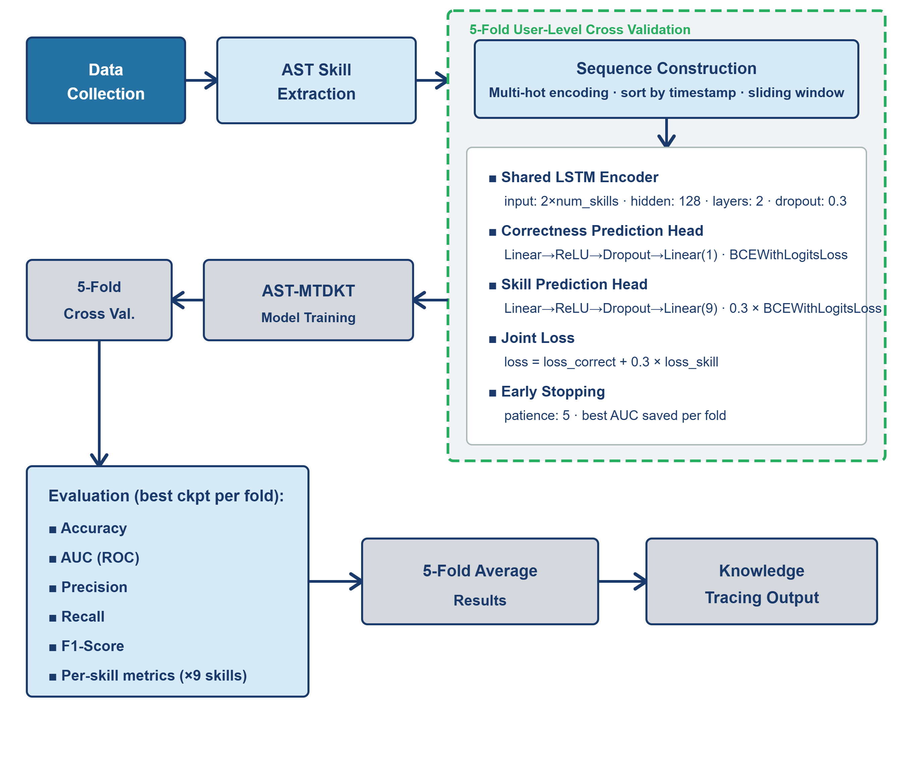
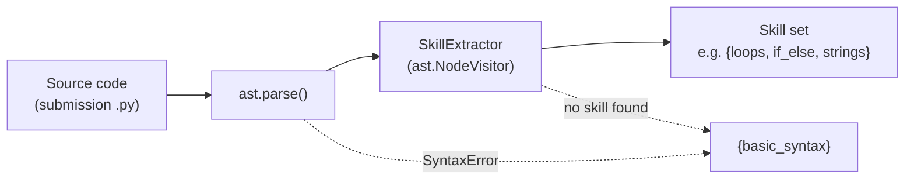
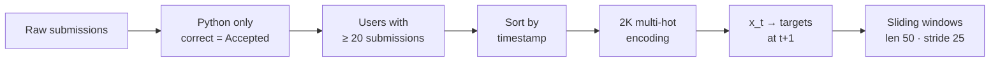
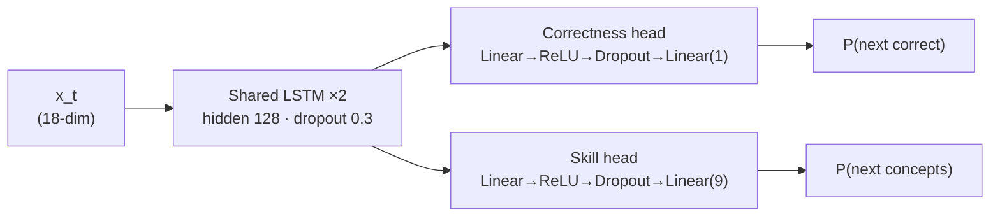
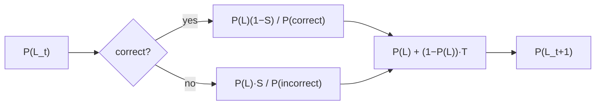

# AST-MTDKT: An AST-Based Multi-Task Deep Knowledge Tracing Framework for Programming Skill Modeling

**Muhammad Jawad Arshad, Yutaka Watanobe**, University of Aizu, Japan

[](paper/AST-MTDKT.pdf)
[](#citation)
[](LICENSE)
[](requirements.txt)
[](https://pytorch.org)

This repository contains the code, results and figures for the paper
[*AST-MTDKT*](paper/AST-MTDKT.pdf), presented at **ICAST 2026** (Ocean University of China).

AST-MTDKT is a knowledge tracing framework for programming education. It parses each student
submission with Python's **Abstract Syntax Tree (AST)** module to find the programming concepts the student used.
It then feeds those concepts into a **multi-task LSTM**, which predicts two things together:

1. **Correctness**: will the student's next submission be accepted?
2. **Concepts**: which programming concepts will appear in the next submission?

> **Main finding.** On 3.29 M Python submissions from 19,049 students in Project CodeNet, AST-MTDKT
> outperforms an AST-based Bayesian Knowledge Tracing baseline. AUC rises from **0.6456 to 0.6774 (+4.93 %)**, and
> accuracy, precision and F1 also improve. The largest per-skill gains are for frequent concepts (if-else, loops,
> strings). Rare concepts remain difficult because of class imbalance.

<p align="center">
  
  <br><em>Figure 1. Overall architecture of AST-MTDKT (from the paper).</em>
</p>

---

## Contents

- [Research question and contributions](#research-question-and-contributions)
- [Dataset](#dataset)
- [Method](#method)
- [Results](#results)
- [Repository structure](#repository-structure)
- [Getting started](#getting-started)
- [Outputs](#outputs)
- [Limitations](#limitations)
- [Future work](#future-work)
- [Citation](#citation)

---

## Research question and contributions

> *To what extent can programming-specific information extracted from source code improve the ability of
> knowledge tracing models to represent programming skill-related behavior over time?*

1. **AST-based skill extraction.** Programming concepts are identified automatically from learners' source code
   with an `ast.NodeVisitor`, with no manual labeling.
2. **Programming-aware knowledge tracing.** AST-derived concept vectors are combined with correctness and fed into
   a shared LSTM learner state.
3. **Multi-task learning.** The model jointly predicts the correctness of the next submission and the
   concepts likely to appear in it.
4. **Empirical evaluation.** The model is evaluated on large-scale Project CodeNet data with leakage-free user-level
   5-fold cross-validation, against an AST-based BKT baseline, plus a feature-source ablation and a sensitivity
   analysis of the loss weight λ.

---

## Dataset

Data comes from **[IBM Project CodeNet](https://github.com/IBM/Project_CodeNet)**, built from submissions to the
Aizu Online Judge and AtCoder. The dataset is **not** included in this repository; download it separately.

| Metric | Value |
|---|---|
| Language | Python |
| Problems | 4,053 |
| Python submissions (interactions) | 3,286,314 (23.61 % of the 13,920,921 CodeNet submissions) |
| Students (≥ 20 submissions) | 19,049 |
| Correctness label | `status == "Accepted"` |
| Evaluation | User-level 5-fold cross-validation |

Python is the second-largest language in CodeNet after C++ (57.53 %). Its volume, and the fact that every
submission can be parsed with the same AST tool, make it a good fit for this study.

---

## Method

### 1 · AST-based skill extraction

Each submission is parsed with `ast.parse`. A custom `ast.NodeVisitor` (`SkillExtractor`) records which of
**9 programming concepts** appear.



| Skill          | Concept                | AST trigger                                       |
|----------------|------------------------|---------------------------------------------------|
| `if_else`      | Conditional statements | `ast.If`                                          |
| `loops`        | `for` / `while` loops  | `ast.For`, `ast.While`                            |
| `functions`    | Function definitions   | `ast.FunctionDef`                                 |
| `recursion`    | Recursive calls        | `ast.Call` whose name equals the enclosing `def`  |
| `arrays_lists` | List usage             | `ast.List`, `.append()`, `.pop()`, `.extend()`    |
| `dictionaries` | Dictionary usage       | `ast.Dict`                                        |
| `strings`      | String manipulation    | `.split()`, `.strip()`, `.replace()`, `.join()`   |
| `algorithms`   | Sorting                | `.sort()`                                         |
| `basic_syntax` | Fallback               | Nothing else detected, or the file fails to parse |

```python
def fact(n):                 # functions
    if n <= 1:               # if_else
        return 1
    return n * fact(n - 1)   # recursion        →  {functions, if_else, recursion}
```

### 2 · Sequence construction



With `K = 9` concepts, each interaction becomes a `2K = 18`-dimensional vector:

```
x_t = [ concepts used in a CORRECT submission (K) | concepts used in an INCORRECT submission (K) ]
```

At step `t` the model sees `x_t` and predicts the **correctness** and the **concept vector** of interaction `t+1`.
`KFold(5, shuffle=True, random_state=42)` splits **user IDs**, so no student appears in both training and
validation data.

### 3 · AST-MTDKT (proposed)



**L = BCE(correctness) + λ · BCE(concepts)**, with **λ = 0.3**. A sweep over
λ ∈ {0.0, 0.1, 0.3, 0.5, 0.7, 1.0, 1.5, 2.0} showed that correctness AUC is very stable (0.6774–0.6778). λ = 0.3 was
kept as a stable low-weight setting that improves the auxiliary task without hurting correctness prediction
([table](#sensitivity-to-the-multi-task-weight-λ)).

### 4 · AST-BKT (baseline)

The baseline uses the same AST features with classical Bayesian Knowledge Tracing. Each concept has **four learnable
parameters**: initial mastery `P(L0)`, learning `P(T)`, guess `P(G)` and slip `P(S)`. They are optimized with Adam, and an
MLP skill head is added for the multi-task objective. Correctness is predicted only from the current interaction,
so no information from future interactions is used.



### Training configuration

| Parameter | AST-MTDKT | AST-BKT |
|---|:-:|:-:|
| Optimizer / learning rate | Adam / 0.001 | Adam / 0.01 |
| Weight decay | 1e-4 | 1e-4 |
| Batch size · max epochs | 32 · 30 | 32 · 30 |
| Early stopping | patience 5 on val AUC | patience 5 on val AUC |
| Gradient clipping | 1.0 | 1.0 |
| Multi-task weight λ | 0.3 | 0.3 |
| Sequence length / stride / min length | 50 / 25 / 5 | 50 / 25 / 5 |
| Random seed | 42 | 42 |

---

## Results

All results are averages over **5 user-level folds**.

### Overall comparison (paper Tables V–VI)

| Metric    | AST-BKT | **AST-MTDKT** | Diff.   | Relative |
|-----------|--------:|--------------:|--------:|---------:|
| Accuracy  | 0.6144  | **0.6383**    | +0.0239 | +3.89 %  |
| AUC       | 0.6456  | **0.6774**    | +0.0318 | +4.93 %  |
| Precision | 0.6262  | **0.6513**    | +0.0251 | +4.01 %  |
| Recall    | **0.7356** | 0.7322     | −0.0034 | −0.46 %  |
| F1-Score  | 0.6764  | **0.6893**    | +0.0129 | +1.91 %  |

AST-MTDKT per-fold AUC: 0.6793, 0.6780, 0.6774, 0.6761, 0.6762 (std ≈ 0.0013). See [`results/ast_mtdkt_fold_results.csv`](results/ast_mtdkt_fold_results.csv).

### Per-skill F1 (paper Table VII)

| Skill        | AST-BKT | AST-MTDKT | Diff.   |
|--------------|--------:|----------:|--------:|
| If-Else      | 0.6543  | **0.8383** | +0.1840 |
| Loops        | 0.6393  | **0.8066** | +0.1673 |
| Functions    | 0.6475  | **0.6797** | +0.0322 |
| Recursion    | **0.5728** | 0.0108 | −0.5620 |
| Arrays/Lists | **0.6129** | 0.5655 | −0.0474 |
| Dictionaries | **0.6119** | 0.0000 | −0.6119 |
| Strings      | 0.6674  | **0.8378** | +0.1704 |
| Algorithms   | **0.6239** | 0.1190 | −0.5049 |
| Basic Syntax | **0.7120** | 0.2895 | −0.4225 |

- AST-MTDKT gives large gains on frequent concepts: **if-else +0.184, strings +0.170, loops +0.167**.
- Recursion, dictionaries, algorithms and basic syntax are rare (for example, recursion appears in about 3 % of next
  submissions). For these, the skill head mostly predicts the majority class, which gives high accuracy but low recall and F1.
- In the notebook, AST-MTDKT's per-skill scores evaluate the **next-concept prediction head**. AST-BKT's per-skill
  scores evaluate **correctness prediction grouped by concept**.

### Ablation: feature source (DKT architecture fixed)

This experiment holds the LSTM architecture, splits and hyperparameters fixed and changes only how the concept labels are produced:

| Feature source | Accuracy | AUC | F1 |
|---|---:|---:|---:|
| AST (proposed) | 0.6383 ± 0.0014 | 0.6776 ± 0.0014 | 0.6834 ± 0.0041 |
| Keyword / regex (non-AST) | 0.6390 ± 0.0015 | 0.6777 ± 0.0015 | 0.6887 ± 0.0040 |
| Random (shuffled labels) | 0.6341 ± 0.0013 | 0.6716 ± 0.0015 | 0.6832 ± 0.0023 |

<p align="center"></p>

Paired t-tests on per-fold AUC: Keyword vs. Random *p* < 0.001; AST vs. Keyword *p* = 0.10. Real concept information
helps clearly compared with shuffled labels. For **correctness** prediction, AST and keyword features perform about the same.
The AST extractor also captures structure that keyword matching cannot, such as recursion.

### Sensitivity to the multi-task weight λ

| λ | Correctness AUC | Accuracy | F1 | Skill macro-F1 |
|---:|---:|---:|---:|---:|
| 0.0 | 0.6775 | 0.6385 | 0.6849 | 0.4060 |
| 0.1 | 0.6774 | 0.6383 | 0.6869 | 0.8124 |
| **0.3** | **0.6776** | **0.6385** | **0.6870** | **0.8248** |
| 0.5 | 0.6778 | 0.6387 | 0.6875 | 0.8298 |
| 0.7 | 0.6777 | 0.6387 | 0.6883 | 0.8308 |
| 1.0 | 0.6778 | 0.6388 | 0.6880 | 0.8315 |
| 1.5 | 0.6778 | 0.6386 | 0.6893 | 0.8319 |
| 2.0 | 0.6778 | 0.6387 | 0.6874 | 0.8321 |

Correctness AUC varies by less than 0.0004 across λ. Turning on the auxiliary task (λ > 0) roughly doubles
concept-prediction F1, so it adds value at no cost to the main task.

---

## Repository structure

```
.
├── paper/
│   └── AST-MTDKT.pdf                         # the paper (ICAST 2026)
├── notebooks/
│   ├── AST-MTDKT.ipynb                       # AST-MTDKT, AST-BKT baseline and feature-source ablation
│   └── Lambda_Sensitivity_Analysis.ipynb     # grid search over the multi-task loss weight λ
├── results/                                  # CSV outputs of the reported runs
├── figures/
│   ├── architecture.png                      # Figure 1 of the paper
│   └── ablation_feature_source.png
├── requirements.txt
├── LICENSE
└── README.md
```

Sections of `notebooks/AST-MTDKT.ipynb`:

| Section | Contents | Checkpoints written |
|---|---|---|
| Background & methodology | Problem, objectives, dataset | — |
| **AST-MTDKT** | AST extraction → sequences → multi-task LSTM → 5-fold CV + per-skill metrics | `best_fold_{1..5}.pt` |
| **AST-BKT** | The same pipeline with the Bayesian Knowledge Tracing baseline | `best_bkt_fold_{1..5}.pt` |
| **Ablation** (4 cells) | AST vs. keyword vs. random features, figure and paired t-tests | `ablation_*_fold_{1..5}.pt` |

---

## Getting started

### 1. Install

```bash
git clone https://github.com/jawad123arshad/AST-MTDKT-An-AST-Based-Multi-Task-Deep-Knowledge-Tracing-Framework-for-Programming-Skill-Acquisition.git AST-MTDKT
cd AST-MTDKT
python -m venv .venv
# Windows: .venv\Scripts\activate    |   Linux/macOS: source .venv/bin/activate

# Install the PyTorch build matching your CUDA driver first: https://pytorch.org/get-started/locally/
pip install -r requirements.txt
```

If no GPU is found, the code falls back to the CPU automatically.

### 2. Get the data

Download and extract Project CodeNet ([instructions](https://github.com/IBM/Project_CodeNet#dataset-download)).
The notebooks expect this layout:

```
Project_CodeNet/
├── metadata/p00000.csv, p00001.csv, ...         # submission_id, user_id, date, language, status, ...
└── data/p00000/Python/s123456789.py, ...
```

Point the notebooks at the folder that contains `metadata/` and `data/`:

```bash
# Windows (PowerShell)
$env:CODENET_PATH = "D:\datasets\Project_CodeNet"
# Linux/macOS
export CODENET_PATH=/data/Project_CodeNet
```

You can also edit the default value in the `DATASET_PATH = os.environ.get("CODENET_PATH", ...)` line of each cell.

### 3. Run

```bash
jupyter notebook notebooks/AST-MTDKT.ipynb
jupyter notebook notebooks/Lambda_Sensitivity_Analysis.ipynb   # optional, ~8× the main runtime
```

Each code cell is **self-contained**, with its own imports, data loading, model and training loop, so the AST-MTDKT,
AST-BKT and ablation experiments can be run independently. Parsing all 4,053 problems takes about **1.5 h**, and
5-fold training adds several hours on a GPU. To check that the pipeline works first, lower the problem count in the cell:

```python
MAX_PROBLEMS = 200   # paper: 4053
```

### 4. Reuse the components

After running the AST-MTDKT cell, its classes and checkpoints can be used on their own:

```python
import ast, torch

extractor = SkillExtractor()
extractor.visit(ast.parse(open("solution.py").read()))
skills = list(extractor.skills) or ["basic_syntax"]

model = MultiTaskDKT(num_skills=9)
model.load_state_dict(torch.load("best_fold_1.pt", map_location="cpu"))
model.eval()

x = torch.zeros(1, 1, 18)               # (batch, time, 2K) interaction history
x[0, 0, skill_to_idx["loops"]] = 1      # a correct submission that used loops
with torch.no_grad():
    correct_logit, skill_logits = model(x)
print("P(next correct):", torch.sigmoid(correct_logit)[0, -1].item())
```

---

## Outputs

Copies of the outputs from the reported runs are in [`results/`](results/):

| File | Contents | Source |
|---|---|---|
| `paper_table_v_overall.csv` | AST-BKT vs. AST-MTDKT overall metrics | Paper, Tables V–VI |
| `paper_table_vii_per_skill_f1.csv` | Per-skill F1 for both models | Paper, Table VII |
| `ast_mtdkt_fold_results.csv` | AST-MTDKT metrics per fold | Notebook output |
| `ast_mtdkt_per_skill.csv` | AST-MTDKT per-skill Acc / P / R / F1 | Notebook output |
| `ablation_fold_results.csv` / `ablation_summary.csv` | Feature-source ablation, per fold and mean ± std | Notebook output |
| `lambda_sensitivity.csv` | Metrics for each λ (mean ± std over 5 folds) | Notebook output |

The AST-MTDKT, ablation and λ runs keep their full training logs in the saved notebook outputs. For AST-BKT, the saved
notebook output is cut off, so its numbers are given as reported in the paper.

---

## Limitations

- **Class imbalance.** Rare concepts (recursion, dictionaries, algorithms) get low concept-prediction F1, because the
  skill head defaults to the majority class.
- **Coarse concept taxonomy.** Nine rule-based concepts capture presence, not quality or correctness of use. For
  correctness prediction, a keyword extractor performs about as well as the AST extractor (see the ablation).
- **Single language and platform.** Only Python submissions from competitive-programming judges are used, so
  results may not transfer to other languages or classroom settings.
- **Single seed.** Results use one random seed (42) with 5 folds. Fold-to-fold variation is small (AUC std ≈ 0.0013).

## Future work

- Class-weighted or focal loss, oversampling and data augmentation for rare concepts.
- Transformer-based knowledge tracing (SAKT, AKT) and graph neural networks over concept relationships.
- Finer-grained AST concepts and evaluation on more languages and datasets.

---

## Citation

If you use this code, please cite:

```bibtex
@inproceedings{arshad2026astmtdkt,
  title     = {AST-MTDKT: An AST-Based Multi-Task Deep Knowledge Tracing Framework for Programming Skill Modeling},
  author    = {Arshad, Muhammad Jawad and Watanobe, Yutaka},
  booktitle = {ICAST 2026},
  address   = {Ocean University of China, China},
  year      = {2026},
  url       = {https://github.com/jawad123arshad/AST-MTDKT-An-AST-Based-Multi-Task-Deep-Knowledge-Tracing-Framework-for-Programming-Skill-Acquisition}
}
```

## License

Code is released under the [MIT License](LICENSE). The paper PDF is © the authors.

Project CodeNet: Puri et al., *Project CodeNet: A Large-Scale AI for Code Dataset for Learning a Diversity of Coding
Tasks*, NeurIPS Datasets and Benchmarks, 2021.
