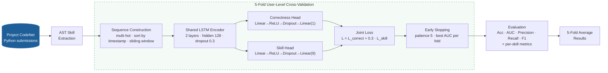
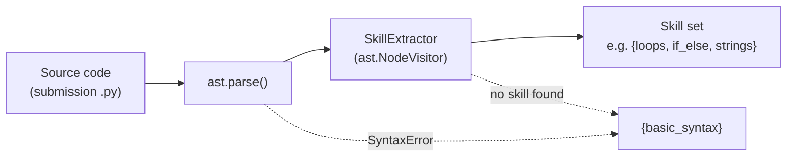
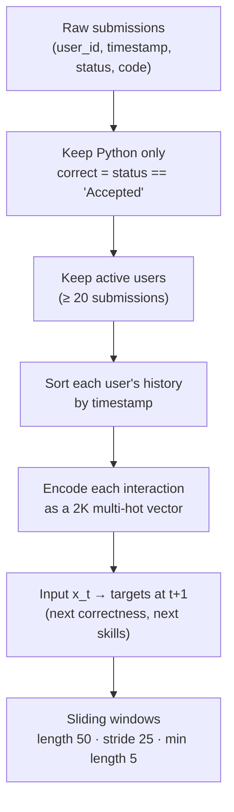
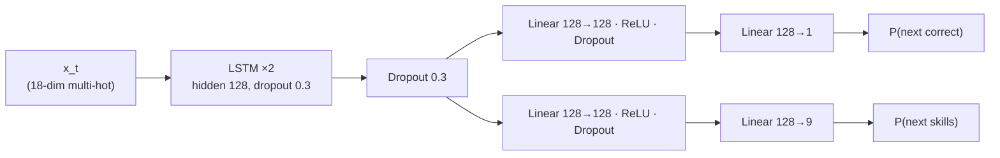
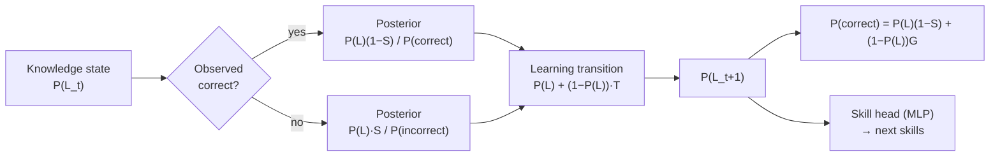
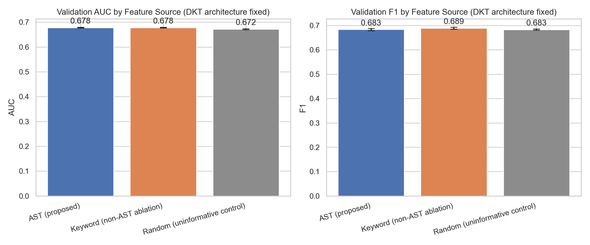

# AST-MTDKT: An AST-Based Multi-Task Deep Knowledge Tracing Framework for Programming Skill Acquisition

Official implementation of **AST-MTDKT**, by Muhammad Jawad Arshad and Yutaka Watanobe (University of Aizu).

AST-MTDKT models how students learn to program. It parses each submission with Python's `ast` module to find
the programming concepts the student used (loops, recursion, dictionaries, and so on), then feeds those concepts into a
**multi-task LSTM**. The LSTM predicts:

1. **Correctness**: will the student's next submission be accepted?
2. **Skills**: which programming concepts will appear in the next submission?

The model is evaluated on **3,286,314 Python submissions from 19,049 students** in
[Project CodeNet](https://github.com/IBM/Project_CodeNet), using **leakage-free, user-level 5-fold
cross-validation**. It is compared against an AST-based multi-task Bayesian Knowledge Tracing baseline (**AST-BKT**).

---

## Table of Contents

- [Framework Overview](#framework-overview)
- [Repository Structure](#repository-structure)
- [AST-Based Skill Extraction](#ast-based-skill-extraction)
- [Sequence Construction](#sequence-construction)
- [Models](#models)
- [Getting Started](#getting-started)
- [How to Run the Code](#how-to-run-the-code)
- [Results](#results)
- [Citation](#citation)

---

## Framework Overview



The study answers one research question: **to what extent can programming-specific information extracted from
source code improve knowledge tracing of programming skill acquisition?**

---

## Repository Structure

```
.
├── notebooks/
│   ├── AST-MTDKT.ipynb                     # Main experiments: AST-MTDKT, AST-BKT baseline, ablation study
│   └── Lambda_Sensitivity_Analysis.ipynb   # Grid search for the multi-task loss weight λ
├── results/
│   ├── ablation_summary.csv                # Ablation: mean ± std over 5 folds
│   ├── ablation_fold_results.csv           # Ablation: per-fold metrics
│   └── ablation_feature_source.png         # Ablation figure
├── requirements.txt
└── README.md
```

The main notebook `notebooks/AST-MTDKT.ipynb` is organised into these sections:

| # | Section | What it does |
|---|---------|--------------|
| 1 | Background & methodology | Problem statement, objectives, dataset description |
| 2 | **AST-MTDKT** (proposed) | AST skill extraction → sequences → multi-task LSTM → 5-fold CV + per-skill metrics |
| 3 | **AST-BKT** (baseline) | Same features and splits, with a Bayesian Knowledge Tracing model in place of the LSTM |
| 4 | **Ablation study** | Fixes the DKT architecture and varies only the feature source (AST, keyword or random) |

The notebook still contains the outputs of the run used in the paper, so you can read every result without re-running it.

---

## AST-Based Skill Extraction

Every submission is parsed with `ast.parse`. A custom `ast.NodeVisitor` (`SkillExtractor`) walks the tree and records
which of **9 programming skills** appear:



| Skill          | Concept                      | AST trigger                                         |
|----------------|------------------------------|-----------------------------------------------------|
| `if_else`      | Conditional statements       | `ast.If`                                            |
| `loops`        | `for` / `while` loops        | `ast.For`, `ast.While`                              |
| `functions`    | Function definitions         | `ast.FunctionDef`                                   |
| `recursion`    | Recursive calls              | `ast.Call` whose name equals the enclosing `def`    |
| `arrays_lists` | List usage                   | `ast.List`, `.append()`, `.pop()`, `.extend()`      |
| `dictionaries` | Dictionary usage             | `ast.Dict`                                          |
| `strings`      | String manipulation          | `.split()`, `.strip()`, `.replace()`, `.join()`     |
| `algorithms`   | Sorting                      | `.sort()`                                           |
| `basic_syntax` | Fallback                     | Nothing else detected, or the file fails to parse   |

Example:

```python
def fact(n):                 # functions
    if n <= 1:               # if_else
        return 1
    return n * fact(n - 1)   # recursion
```
→ `{functions, if_else, recursion}`

---

## Sequence Construction



**Multi-hot encoding.** With `K = 9` skills, each interaction is a `2K = 18`-dimensional vector:

```
x_t = [ skills used in a CORRECT submission (K) | skills used in an INCORRECT submission (K) ]
```

At step `t` the model sees `x_t` and predicts the **correctness** and the **skill vector** of interaction `t+1`.

**Leakage-free evaluation.** `KFold(n_splits=5, shuffle=True, random_state=42)` splits **user IDs**, not interactions,
so no student appears in both the training and validation sets of the same fold.

---

## Models

### AST-MTDKT (proposed)



Loss: `L = BCEWithLogits(correct) + λ · BCEWithLogits(skills)`, with **λ = 0.3**.

### AST-BKT (baseline)

Classical Bayesian Knowledge Tracing with **four learnable parameters per skill**: initial mastery `P(L0)`,
learning `P(T)`, guessing `P(G)` and slipping `P(S)`. The parameters are trained by gradient descent.



Only the skills of the **current** interaction are used to update the state and predict correctness, so no
information from future interactions leaks in.

### Training configuration

| Parameter               | AST-MTDKT | AST-BKT |
|-------------------------|-----------|---------|
| Optimizer               | Adam      | Adam    |
| Learning rate           | 0.001     | 0.01    |
| Weight decay            | 1e-4      | 1e-4    |
| Batch size              | 32        | 32      |
| Max epochs              | 30        | 30      |
| Early stopping          | patience 5 on val AUC | patience 5 on val AUC |
| Gradient clipping       | 1.0       | 1.0     |
| Multi-task weight λ     | 0.3       | 0.3     |
| Sequence length / stride| 50 / 25   | 50 / 25 |
| Min. submissions / user | 20        | 20      |
| Problems sampled        | 4053      | 4053    |
| Random seed             | 42        | 42      |

---

## Getting Started

### 1. Clone the repository

```bash
git clone https://github.com/jawad123arshad/AST-MTDKT-An-AST-Based-Multi-Task-Deep-Knowledge-Tracing-Framework-for-Programming-Skill-Acquisition.git
cd AST-MTDKT-An-AST-Based-Multi-Task-Deep-Knowledge-Tracing-Framework-for-Programming-Skill-Acquisition
```

### 2. Create an environment and install dependencies

```bash
python -m venv venv
# Windows
venv\Scripts\activate
# Linux / macOS
source venv/bin/activate

pip install -r requirements.txt
```

For GPU training, install the CUDA build of PyTorch that matches your system
([pytorch.org/get-started](https://pytorch.org/get-started/locally/)). If no GPU is found, the code falls back to the CPU automatically.

### 3. Download Project CodeNet

Download **Project_CodeNet.tar.gz** from the [Project CodeNet repository](https://github.com/IBM/Project_CodeNet)
and extract it. The code expects this layout:

```
Project_CodeNet/
├── metadata/
│   ├── p00000.csv          # one CSV per problem: submission_id, user_id, date, language, status, ...
│   ├── p00001.csv
│   └── ...
└── data/
    ├── p00000/
    │   └── Python/
    │       ├── s123456789.py
    │       └── ...
    └── ...
```

> The dataset is about 8 GB compressed and is **not** included in this repository.

---

## How to Run the Code

### Step 1: Point the notebook to your dataset

Each experiment cell defines the dataset path near the top. Change it to the folder where you extracted CodeNet:

```python
DATASET_PATH = r"C:\path\to\Project_CodeNet"     # Windows
# DATASET_PATH = "/home/you/data/Project_CodeNet"  # Linux / macOS
```

Each cell is **self-contained** (it has its own imports, data loading and model code), so update `DATASET_PATH` in
every cell you plan to run.

### Step 2: Start Jupyter

```bash
jupyter notebook notebooks/AST-MTDKT.ipynb
```

### Step 3: Run the experiments

| Cell in `AST-MTDKT.ipynb`           | Output                                                            | Checkpoints written             |
|-------------------------------------|-------------------------------------------------------------------|---------------------------------|
| **AST-MTDKT** (first code cell)     | Per-fold and average Acc / AUC / Precision / Recall / F1 + per-skill table | `best_fold_{1..5}.pt`     |
| **AST-BKT** baseline                | The same metrics for the BKT baseline                             | `best_bkt_fold_{1..5}.pt`       |
| **Ablation** (4 cells, run in order)| AST vs. keyword vs. random features, a summary figure and paired t-tests | `ablation_*_fold_{1..5}.pt`, `ablation_*.csv`, `ablation_feature_source.png` |

To run the λ sensitivity analysis:

```bash
jupyter notebook notebooks/Lambda_Sensitivity_Analysis.ipynb
```

It outputs a table of metrics for each λ and saves `lambda_sensitivity_analysis.png`.

### Runtime and quick testing

Parsing the full dataset (4,053 problems, 3.2 M submissions) takes about **1.5 hours**. Training each model for 5 folds
adds several hours on a GPU. For a quick test, lower the number of problems in the loading section:

```python
MAX_PROBLEMS = 200   # default 4053 (the full experiment in the paper)
```

### Using the components in your own code

Once you have run the AST-MTDKT cell, its classes and its checkpoints can be reused on their own:

```python
import ast, torch

# 1) Extract skills from any Python source
code = open("solution.py").read()
extractor = SkillExtractor()
extractor.visit(ast.parse(code))
skills = list(extractor.skills) or ["basic_syntax"]
print(skills)

# 2) Load a trained AST-MTDKT checkpoint and predict
model = MultiTaskDKT(num_skills=9)
model.load_state_dict(torch.load("best_fold_1.pt", map_location="cpu"))
model.eval()

x = torch.zeros(1, 1, 18)               # (batch, time, 2K) multi-hot history
x[0, 0, skill_to_idx["loops"]] = 1      # e.g. a correct submission that used loops
with torch.no_grad():
    correct_logit, skill_logits = model(x)
print("P(next correct):", torch.sigmoid(correct_logit)[0, -1].item())
print("P(next skills): ", torch.sigmoid(skill_logits)[0, -1])
```

---

## Results

All numbers are averages over **5 user-level folds** on 3,286,314 interactions from 19,049 students.

### Overall comparison

| Metric    | AST-BKT | **AST-MTDKT** | Diff.   | Rel. improvement |
|-----------|---------|---------------|---------|------------------|
| Accuracy  | 0.6144  | **0.6383**    | +0.0239 | +3.89 %          |
| AUC       | 0.6456  | **0.6774**    | +0.0318 | +4.93 %          |
| Precision | 0.6262  | **0.6513**    | +0.0251 | +4.01 %          |
| Recall    | **0.7356** | 0.7322     | −0.0034 | −0.46 %          |
| F1-Score  | 0.6764  | **0.6893**    | +0.0129 | +1.91 %          |

### Per-skill F1

| Skill        | AST-BKT | AST-MTDKT | Diff.   |
|--------------|---------|-----------|---------|
| If-Else      | 0.6543  | **0.8383** | +0.1840 |
| Loops        | 0.6393  | **0.8066** | +0.1673 |
| Functions    | 0.6475  | **0.6797** | +0.0322 |
| Recursion    | **0.5728** | 0.0108 | −0.5620 |
| Arrays/Lists | **0.6129** | 0.5655 | −0.0474 |
| Dictionaries | **0.6119** | 0.0000 | −0.6119 |
| Strings      | 0.6674  | **0.8378** | +0.1704 |
| Algorithms   | **0.6239** | 0.1190 | −0.5049 |
| Basic Syntax | **0.7120** | 0.2895 | −0.4225 |

AST-MTDKT is strongest on common concepts (if-else, loops, strings). Rare concepts (recursion, dictionaries) are
heavily imbalanced, so the skill head tends to predict the majority class for them.

> **What the per-skill scores measure.** In the notebook, AST-MTDKT's per-skill scores evaluate the **next-skill prediction head**,
> that is, whether the skill appears in the next submission. AST-BKT's per-skill scores evaluate **correctness prediction grouped
> by skill**.

### Ablation: feature source (DKT architecture fixed)

| Feature source                 | Accuracy        | AUC             | F1              |
|--------------------------------|-----------------|-----------------|-----------------|
| AST (proposed)                 | 0.6383 ± 0.0014 | 0.6776 ± 0.0014 | 0.6834 ± 0.0041 |
| Keyword (non-AST)              | 0.6390 ± 0.0015 | 0.6777 ± 0.0015 | 0.6887 ± 0.0040 |
| Random (shuffled labels)       | 0.6341 ± 0.0013 | 0.6716 ± 0.0015 | 0.6832 ± 0.0023 |

Paired t-tests on per-fold AUC: AST vs. Keyword *p* = 0.103; Keyword vs. Random *p* < 0.001.
Real skill information (AST or keyword) clearly beats shuffled labels. AST and keyword features perform about the same
on correctness prediction.



### Sensitivity to the multi-task weight λ

| λ   | AUC    | Accuracy | F1     | Skill macro-F1 |
|-----|--------|----------|--------|----------------|
| 0.0 | 0.6775 | 0.6385   | 0.6849 | 0.4060         |
| 0.1 | 0.6774 | 0.6383   | 0.6869 | 0.8124         |
| **0.3** | **0.6776** | **0.6385** | **0.6870** | **0.8248** |
| 0.5 | 0.6778 | 0.6387   | 0.6875 | 0.8298         |
| 0.7 | 0.6777 | 0.6387   | 0.6883 | 0.8308         |
| 1.0 | 0.6778 | 0.6388   | 0.6880 | 0.8315         |
| 1.5 | 0.6778 | 0.6386   | 0.6893 | 0.8319         |
| 2.0 | 0.6778 | 0.6387   | 0.6874 | 0.8321         |

Correctness AUC barely changes with λ (within ±0.0004). Skill-prediction F1 roughly doubles once λ > 0. This shows the
auxiliary task can be learned without hurting the primary correctness task.

---

## Future Work

- Class-weighted or focal loss and oversampling for rare skills (recursion, dictionaries)
- Transformer-based knowledge tracing (SAKT, AKT) in place of the LSTM
- Graph neural networks that model relationships between programming concepts
- Other programming languages and datasets

---

## Citation

If you use this code, please cite:

```bibtex
@misc{arshad2026astmtdkt,
  title  = {AST-MTDKT: An AST-Based Multi-Task Deep Knowledge Tracing Framework for Programming Skill Acquisition},
  author = {Arshad, Muhammad Jawad and Watanobe, Yutaka},
  year   = {2026},
  note   = {University of Aizu},
  url    = {https://github.com/jawad123arshad/AST-MTDKT-An-AST-Based-Multi-Task-Deep-Knowledge-Tracing-Framework-for-Programming-Skill-Acquisition}
}
```

## Acknowledgments

- [Project CodeNet](https://github.com/IBM/Project_CodeNet) (IBM), built from submissions to the Aizu Online Judge and AtCoder.
- Department of Computer Science and Engineering, University of Aizu, Japan.
